# Blueprint Studio

[](https://github.com/XiRuize/dsh-blueprint-studio/actions/workflows/ci.yml)
[](LICENSE)

**Draw the system before you build it.**

Blueprint Studio is a [DeepSeek Harness](https://github.com/deepseek-ai/deepseek-harness) plugin that turns a one-line request into a collaborative software-engineering blueprint: requirement columns, eight kinds of diagram, version history, and a live dispatch board for per-module subagents. You edit the blueprint by hand or ask the agent to expand it, then confirm — and the agent dispatches **one subagent per module**.

> 中文简介：写代码前先让 AI 把需求、用例、数据流、时序、ER、C4 和模块关系画清楚；人可以逐条修改、补图、一键扩充，确认后由 AI 按模块分派子代理并行实施。每次保存自动归档版本，可对比、可恢复。

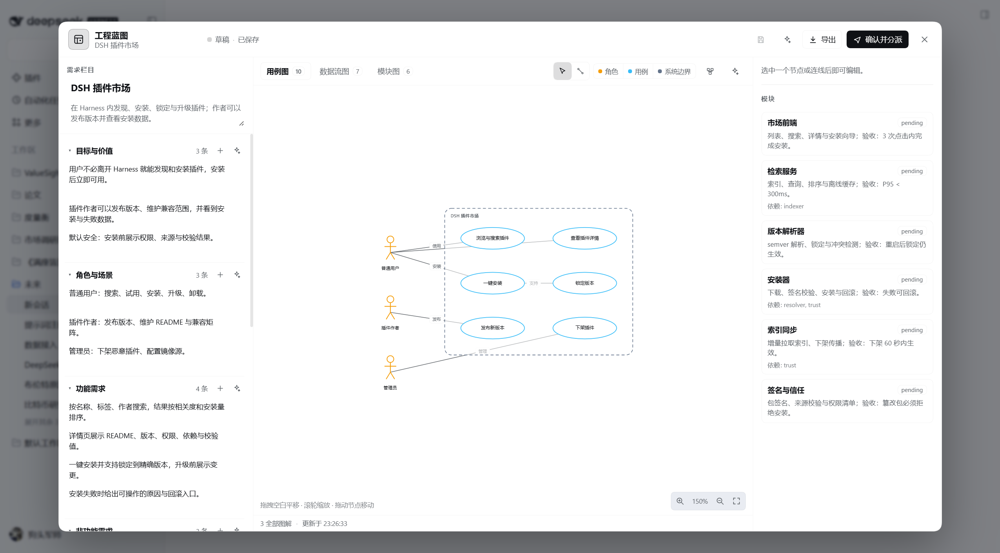

| Sequence | ER |
| --- | --- |
| 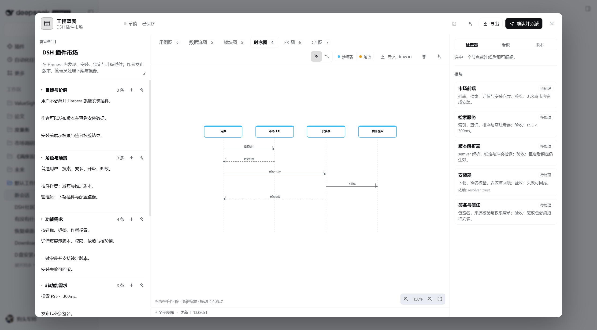 | 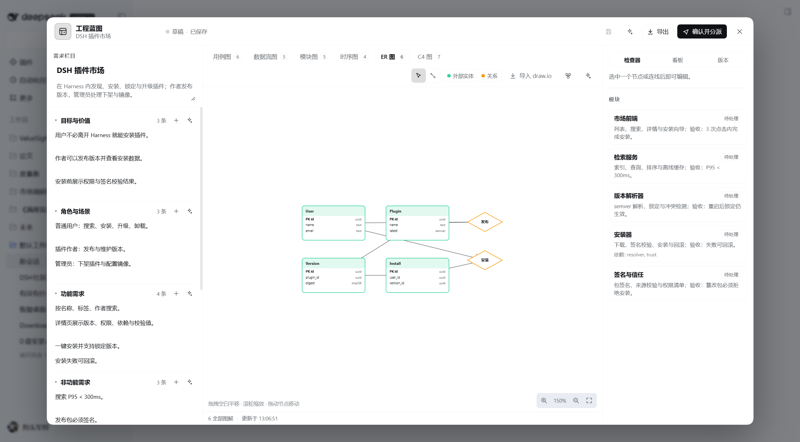 |

| C4 | Data flow | Modules |
| --- | --- | --- |
| 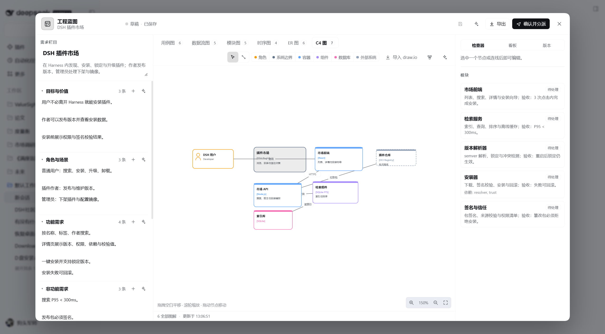 | 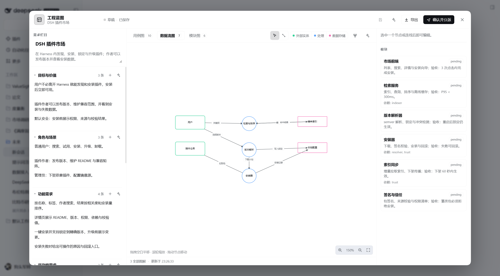 | 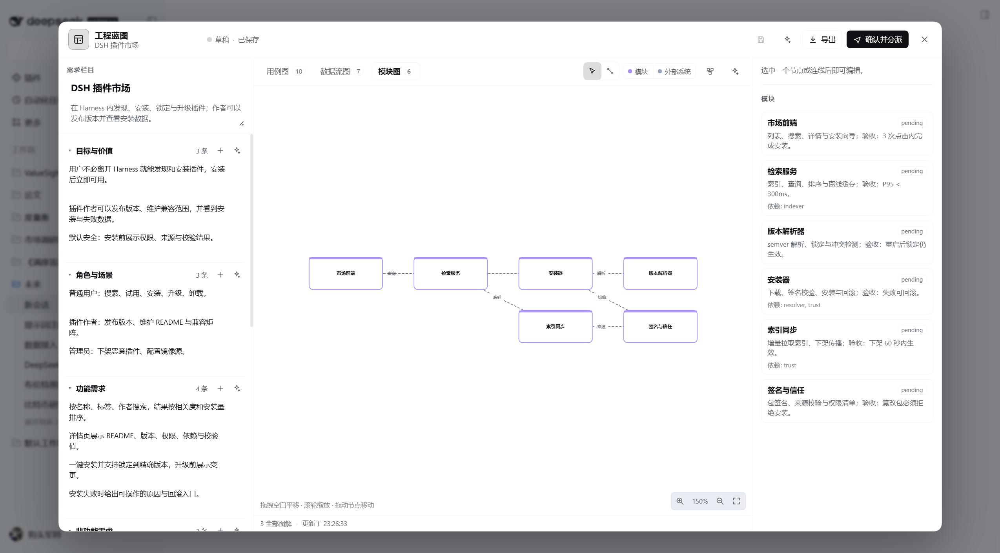 |

```
prompt ──▶ requirements ──▶ diagrams ──▶ human review ──▶ confirm ──▶ N subagents
             (7 columns)     (9 views)    edit / expand / diff            (per module)
```

## Why

Agents are fast at writing code and bad at guessing intent. A blueprint is a cheap, reviewable contract:

- **Requirements are visible** rather than buried in a chat transcript.
- **Diagrams expose missing actors, stores, messages, entities and boundaries** before they become architecture.
- **Modules become dispatch units** with explicit scope, dependencies and acceptance criteria.
- **Every save is a version** — compare what the agent changed against what you changed, and restore in one click.
- **Humans stay in control** of the expensive decision (what to build), not the cheap one (which file to edit).

## Features

- **Seven requirement columns** — goals, actors, functional, non-functional, constraints, acceptance, risks; every item is editable, addable and removable.
- **Nine editable diagrams**
  - UML use case: actors, use cases, system boundary;
  - data flow: external entity, process, data store, labelled flows;
  - module dependency;
  - sequence: participants, ordered sync/async/return messages;
  - ER: entities with typed fields and primary keys, relationship diamonds, cardinality;
  - C4: person, system, container, component, database, external system, with technology and responsibility labels;
  - class: classes/interfaces, fields and methods, extends/implements/association/dependency;
  - state: states, initial/final, choice, labelled transitions;
  - **plan flowchart**: start/end, process, decision, group container, note; labelled solid/dashed edges, top-down orthogonal layout, collapsible groups.
- **Visual editing on an SVG canvas** — drag nodes, pan/zoom, connect nodes, edit labels and edge kinds, ER field editor, delete, deterministic auto-layout.
- **Undo / redo** — `Ctrl+Z` and `Ctrl+Shift+Z` / `Ctrl+Y`, plus toolbar buttons. Fast typing and dragging coalesce into one step; a save or an agent update does not silently discard the local undo stack.
- **Welcome screen round-trip** — one click returns from the manual editor to the initial generate screen; “继续编辑当前蓝图” brings you back without losing the file.
- **Offline welcome templates** — five starters (web app, CLI, data pipeline, DSH plugin, implementation plan) create a complete draft with requirements and modules in one click, without calling the agent. The implementation-plan starter ships a populated plan flowchart with decisions, groups, verification and rollback.
- **AI generate / expand** — one button sends a focused instruction to the agent; the studio refreshes when the agent writes the blueprint.
- **Version history** — every agent or human save archives the previous content. Compare any two versions with a semantic diff (requirements, nodes, edges, fields, modules) including concrete added/removed node and edge labels; restore a version with one click; create manual snapshots.
- **Requirement ↔ node ↔ module traceability** — link any diagram node to one or more requirement items, attach nodes/files/acceptance criteria to a module, highlight linked nodes from the requirement list, and pass the linked scope into dispatch prompts.
- **Live dispatch board** — child subagent sessions of the current conversation, refreshed every five seconds, with module status, one-click navigation, cancel, retry, and manual status updates.
- **Layered module scopes** — root layer `A`, child layers `B`/`C`/…, module codes `A1`/`B1`; double-click a module or use its corner button to drill down, or jump directly with the persistent A/B/C layer bar; breadcrumbs to return, nine diagrams per layer created lazily.
- **Repository graph** — scan size/languages/tests/docs/health, expandable file tree, alias-aware import graph (TS/JS/Python/Go/Rust), module + import SVG previews, and layered A/B/C structure.\n- **Repository scan & deep validation** — scan manifests/packages/languages/tests/deps, suggest mounts/modules/diagrams, and validate eight diagram types with concrete fixes.\n- **SVG review & project review** — review pages embed all nine diagrams as inline SVG; `/blueprint review project [html]` aggregates every blueprint with cross-project gaps; Lineage is now an interactive DAG.\n- **HTTP / dsh runners** — reference HTTP POST runner and dsh-subagent prompt bridge, both dry-run by default.\n- **Safety and lineage** — handoff policy allowlist/denylist, read-only mount refusal, output/time caps and JSONL audit; plus a read-only Lineage timeline merging versions and runs.\n- **Reference runner** — dependency-free `examples/handoff-runner/runner.mjs`: dry-run by default, explicit `--execute` for cli commands, captures evidence and writes result.json for collect.\n- **Handoff jobs** — prepare a durable handoff.json for an active run, let an external agent/CLI execute it, then collect result.json back into the ledger with evidence, status and next action; heartbeat renews the lease.\n- **Review & handoff** — a deterministic review packet and printable single-file HTML covering requirements, modules, mounts, runs/evidence, gaps and next actions; advisory manual/cli/http/dsh-subagent handoff descriptors never execute commands.\n- **Execution Ledger** — durable module runs with mount claims/leases, base snapshots, evidence, status and an advisory rollback plan; `/blueprint run` commands and a Runs panel make long-running dispatch resumable without turning a completed run into automatic acceptance.\n- **Workspace Map** — bind modules to working directories, snapshots and archives via stable mounts; the Workspace tab edits mounts and module mappings, checks flag dangling refs/overlaps/read-only writes, and dispatch packets carry cwd, writable scope, commands, agent profile and snapshot refs.\n- **Complex-task layering** — prompts and checks force child layers for ≥6 modules, ≥3 domains, multiple adapters or parallel subagents; the requirement panel flags a flat complex blueprint and points to the module panel.\n- **Global search** — requirement code/text, module code/name/summary and layer letter/title; results jump to the right layer, diagram and node.
- **Markdown/HTML export** — current-layer or all-layer Markdown and a single-file offline HTML review page, exposed through `/blueprint export`.
- **Plan mode** — a built-in plan contract (goal/non-goal, constraints, ordered steps, decision branches, parallel groups, verification, rollback) and a five-step starter template; the agent must produce a plan flowchart and wait for confirmation before coding.
- **Layered acceptance verification** — every module carries independent `tests` / `reviewer` / `human` layers with evidence. `/blueprint verify` records a layer, a failed layer forces `needs-rework`, and only three passes can make a module `done`; the Modules panel shows all three layers and records verification without leaving the studio.
- **Self-check and coverage** — 34 structural/coverage rules, 9 plan-mode rules and type-specific deep diagram validation, and a requirement-module matrix through `/blueprint check` and the Checks panel.
- **Stable-ID requirement review** — added/removed/modified by `uid`, word-level highlighting, and per-item accept/reject with undo.
- **draw.io & Mermaid interop** — import `.drawio`/XML or Mermaid by paste or file, replacing or appending to the target diagram; export the current diagram back to draw.io XML or Mermaid.
- **One-click dispatch** — confirmation marks the blueprint `confirmed` and asks the agent to spawn one subagent per module, respecting dependencies.
- **Local-first storage** — `<workspace>/.dsh/blueprints/<sessionId>.json`, reviewable and diffable in Git.
- **Exports** — JSON, Mermaid (flowchart, sequence, ER), SVG, draw.io XML.
- **Bilingual UI** — English and 简体中文, with an explicit `中 / EN` header switch that persists across sessions.

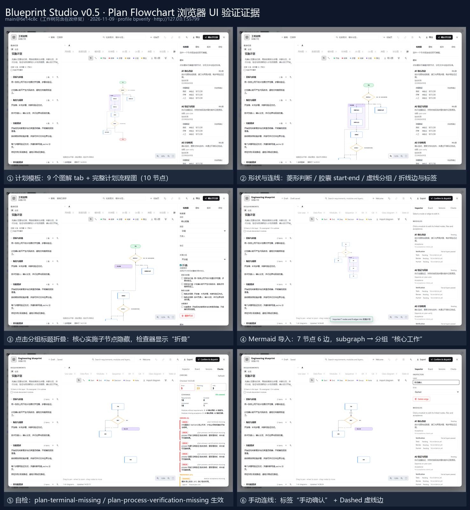

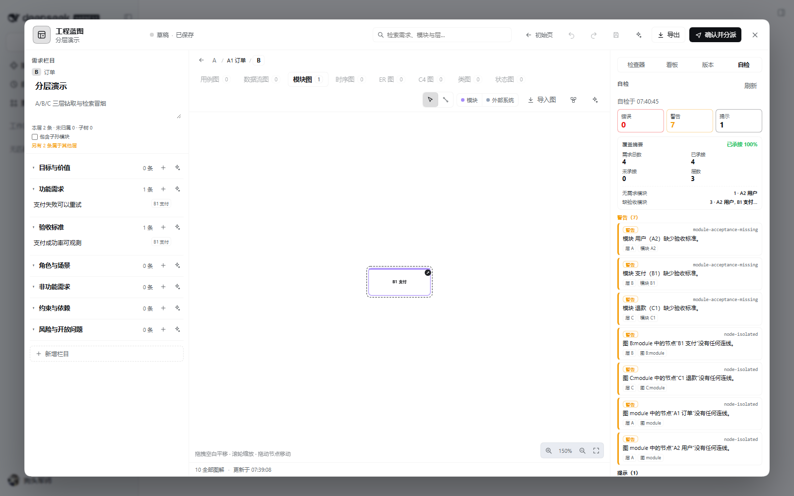

## Install

### Install from npm

Once the package is published to the public npm registry, add it to a profile with the Harness CLI:

```bash
dsh plugin --profile <profile> add dsh-blueprint-studio
```

This is the shortest path when npm is available. The package has no runtime dependencies and no build step, so installation is a plain registry download.

> **Package name availability.** Before the first npm release, `dsh-blueprint-studio` must still be unclaimed on [npm](https://www.npmjs.com/package/dsh-blueprint-studio). If install reports a 404, the release has not been published yet — use one of the fallbacks below. See [Publishing](#publishing) for the CI setup.

### Install from a release tarball (no npm, no git)

A GitHub URL is a **git dependency**: pnpm shells out to `git ls-remote`, so it fails on machines without Git in `PATH` (`'git' is not recognized`). Install the packaged tarball instead — it is a plain HTTPS download and needs no npm, Git or build step:

```bash
dsh plugin --profile <profile> add \
  https://github.com/XiRuize/dsh-blueprint-studio/releases/download/v0.18.0/dsh-blueprint-studio-0.18.0.tgz
```

Or download `dsh-blueprint-studio-0.18.0.tgz` from [Releases](https://github.com/XiRuize/dsh-blueprint-studio/releases) and point `install_bundle` at the local `.tgz` / extracted directory.

If you prefer the git URL, install Git for Windows first (`winget install --id Git.Git -e`) and reopen the terminal. Behind a proxy, set `HTTPS_PROXY` for pnpm, or configure Git's proxy/SSH transport separately.

### Install from a local checkout

Install the workspace bundle with the Harness plugin manager:

```text
plugin_manager(action="install_bundle", target="<absolute path to dsh-blueprint-studio>")
```

The bundle inserts two rows: a Host plugin (`blueprint` tool, `/blueprint` command, system-prompt section) and a Web client half (composer button + full-screen studio). No build step and no runtime dependencies are required.

After installation, open any conversation. A **Blueprint / 蓝图** button appears in the composer tool row. The agent is also instructed to create a blueprint before multi-step implementation work.

> **Reload required after a fresh install.** The Host half is live as soon as `install_bundle` reports `applied`. The Web client half is part of the boot graph, so reload the page — or restart the desktop app — once; otherwise the composer button and studio are not mounted. Editing `client.js` later also needs a reload unless the deployment runs `pnpm run dev:web` for live client HMR.

## Usage

1. Send a task prompt. For a non-trivial coding task the agent calls `blueprint(action="create")` before touching files.
2. Click **蓝图** in the composer. The studio opens on the **welcome screen** when no blueprint exists: type the task and click **生成蓝图**, pick one of the four templates, or choose **手动开始** for a blank canvas.
3. Refine:
   - edit any requirement inline, add items or whole sections;
   - undo mistakes with `Ctrl+Z`, redo with `Ctrl+Y` / `Ctrl+Shift+Z`;
   - drag nodes, add nodes from the toolbar, switch to **Connect** and click two nodes;
   - for ER entities, add fields and mark primary keys in the inspector;
   - use **Auto layout** to re-run the deterministic layout;
   - click ✨ on a section or a diagram to ask the agent to expand only that part.
4. Click **初始页** to go back to the welcome screen at any time; **继续编辑当前蓝图** returns to the same file.
5. Use **Versions** to compare the last agent revision with your edits, restore an older version, or save a named snapshot.
6. Use **Board** to watch child subagents after dispatch.
7. Click **Confirm & dispatch**. The blueprint is saved as `confirmed`, then the agent is instructed to:
   - read the latest blueprint,
   - mark it `dispatched`,
   - start one subagent per module (dependencies first, independent modules in parallel),
   - write each child session id back to the module and update status.

### Welcome templates

Four offline starters create a complete draft in one click — no agent call and no network:

| Template | Scope |
| --- | --- |
| Web application | frontend, backend, database, auth |
| CLI tool | command parsing, execution, config, output |
| Data pipeline | ingest, clean, store, schedule |
| DSH plugin | host tool, client panel, storage, tests |

Each starter fills all seven requirement columns, keeps the eight diagram slots (use case, data flow and module populated; sequence/ER/C4/class/state left empty for you or the agent) and adds 3–4 modules with dependencies. Positions are computed by the existing auto-layout, so templates never hard-code geometry. Applying a template resets the undo stack, saves silently and shows a toast; save errors stay visible in the panel.

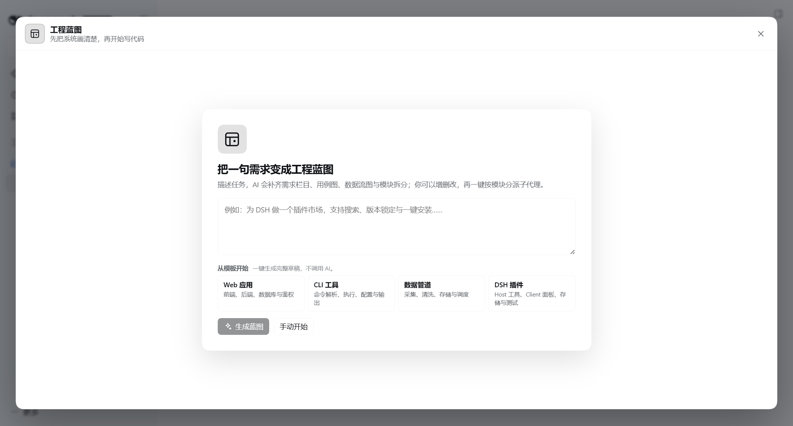
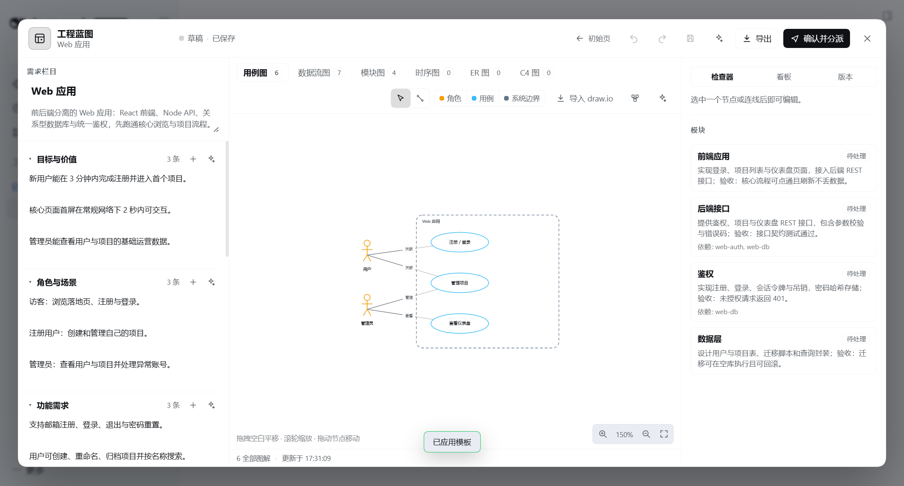

### Undo, welcome and versions

| Editor: undo/redo + 初始页 | Welcome: generate or continue |
| --- | --- |
| 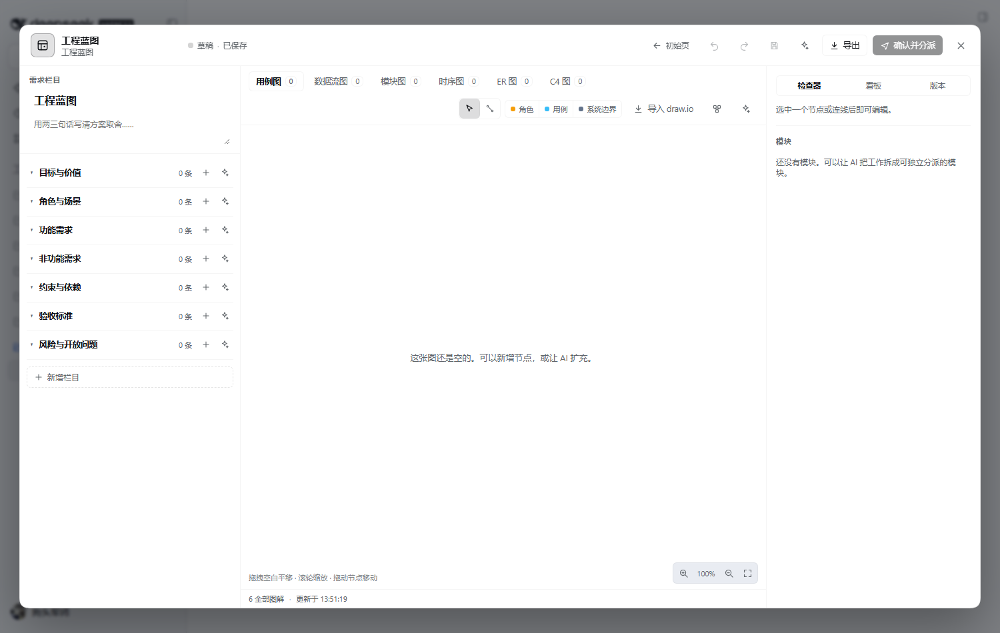 | 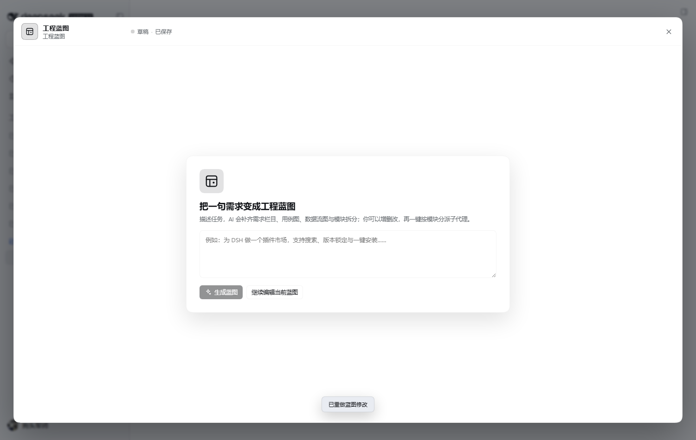 |

Undo is local to the open studio (up to 60 snapshots). It is not the same as version history: undo changes the working copy and marks it dirty, while **Save** / snapshot archives a version. This separation lets you undo freely and still keep every saved revision.

### Version history

```
.dsh/blueprints/
├── <sessionId>.json                 # current blueprint
└── <sessionId>.versions/
    ├── index.json                   # lightweight manifest (last 40)
    ├── v-xxxx.json                  # archived blueprint
    └── v-yyyy.json
```

Versions are archived automatically before every write (agent tool or studio save), plus manual snapshots. The index stores time, source (`agent` / `ui` / `manual`), label, status and counts. Diff is computed on the Host (`semanticDiff`) and rendered as a three-column review: requirements, diagrams, modules.

### draw.io import

Click **Import draw.io** in the diagram toolbar, then paste XML or choose a `.drawio`/`.xml` file. The parser maps `mxCell` vertices and edges into the current diagram:

- `shape=umlActor` → actor; `ellipse` → use case/process; `rhombus` → relationship; `cylinder` → store/database; `swimlane` → system; component/container heuristics for C4;
- geometry is preserved, so the imported layout stays where the author drew it;
- choose **Replace current diagram** or append with a generated id suffix.

Export the current diagram as draw.io XML from **Export → draw.io XML**.

### Mermaid import

Click **Import diagram** in the diagram toolbar and choose **Mermaid** (or leave **Auto detect** on and paste Mermaid text). The toolbar dialog accepts a paste or a `.mmd`/`.mermaid`/`.txt` file:

- `classDiagram` → the class diagram: `class` nodes, `+name: type` fields, `+method() return` methods, `<|--` extends, `<|..` implements, `-->` association, `..>` dependency;
- `stateDiagram-v2` → the state diagram: `[*] --> State` initial, `State --> [*]` final, `A --> B : label` transitions, `state "Label" as id`;
- `flowchart TD/LR` (or `graph`) → the **plan flowchart**: `A[Step]`, `A{Decision}`, `([Start])`/`([End])`, `subgraph` groups, labelled edges such as `A -- label --> B`, `-->|label|`, and `-.->` dashed edges;
- `%%` comments and blank lines are ignored; `subgraph` becomes a group container. Notes are exported as comments and are therefore not round-tripped; `condition`, `owner`, `verification` and `collapsed` are GUI-only metadata and are not encoded in Mermaid.

Mermaid import is intentionally strict: input over 200 KB or more than 200 parsed nodes is rejected with a bilingual error. Members that cannot be mapped are kept as a field with note `unparsed member`, so no source text is silently dropped.

Export the current diagram as Mermaid from **Export → Mermaid**.

## Data model

The tool accepts a compact, model-friendly object; layout is computed in the browser so the model never has to invent pixel coordinates.

```json
{
  "title": "Plugin marketplace",
  "summary": "Browse, install and pin plugins inside DSH.",
  "prompt": "Build a plugin marketplace…",
  "sections": [
    { "key": "functional", "title": "Functional requirements", "items": ["Search by name and tag"] }
  ],
  "diagrams": [
    {
      "key": "usecase",
      "nodes": [
        { "id": "u", "type": "actor", "label": "DSH user" },
        { "id": "browse", "type": "usecase", "label": "Browse plugins" },
        { "id": "sys", "type": "system", "label": "Marketplace" }
      ],
      "edges": [{ "from": "u", "to": "browse", "label": "uses" }]
    }
  ],
  "modules": [
    { "id": "search", "name": "Search", "summary": "Index, query, ranking; acceptance: …", "dependsOn": [] }
  ]
}
```

Node types by diagram:

| Diagram | Node types | Edge notes |
| --- | --- | --- |
| `usecase` | `actor`, `usecase`, `system` | `association`, `include`, `extend` |
| `dfd` | `entity`, `process`, `store` | `flow`, label = data name |
| `module` | `module`, `external` | `depends` |
| `sequence` | `participant`, `actor` | `kind: sync \| async \| return`, `order` |
| `er` | `entity` (with `fields`), `relationship` | `cardinality: "1..*"` |
| `c4` | `person`, `system`, `container`, `component`, `database`, `external` | `technology` on nodes/edges |

ER field:

```json
{ "name": "id", "type": "uuid", "key": true }
```

Sequence message:

```json
{ "from": "user", "to": "api", "label": "GET /plugins", "kind": "sync", "order": 1 }
```

## Agent contract

The Host half contributes:

- a `blueprint` tool with `create | update | get | confirm | dispatch | snapshot | delete`;
- a `/blueprint` command used by the studio for `save`, `verify`, `versions`, `diff`, `restore`, `snapshot`, `path`, `get`, `export`, `check`;
- a system-prompt section that tells the agent to plan before coding, wait for confirmation, dispatch per-module subagents, record child session ids, and update module status.

The studio writes through the **public** `commands.execute` Remote and reads through `workspaceFiles.read`; child subagents come from `session.list`. It never needs a private RPC bridge. That keeps the plugin compatible with the shipped Harness API surface.

## Architecture

```
┌──────────────────────────── Browser (client.js) ───────────────────────────┐
│ composer button ──▶ Studio overlay (React, SVG canvas, zero runtime deps)   │
│        │ read                     │ write / prompt           │ list        │
└────────┼──────────────────────────┼──────────────────────────┼─────────────┘
         ▼                          ▼                          ▼
  workspaceFiles.read        commands.execute           session.list
  blueprint + versions       /blueprint save|diff|…      child subagents
         │                          │                          │
┌────────┼──────────────────────────┼──────────────────────────┼─────────────┐
│ Host   ▼                          ▼                          ▼             │
│  blueprint tool ── normalize ── atomic JSON write ── version archive        │
│  semanticDiff ── /blueprint command ── system-prompt section               │
└────────────────────────────────────────────────────────────────────────────┘
```

- **Source of truth**: a JSON file in the workspace, so the agent, the human and Git all see the same artifact.
- **Deterministic layout**: the model produces semantics (nodes/edges/fields), the client produces geometry.
- **No custom RPC**: reads use `workspaceFiles`, writes use a recorded command; both are shipped, authorized Remotes.
- **Session-scoped**: one blueprint and one history per session, keyed by session id.

## Prior art and why a custom renderer

The diagram space is crowded, but most tools optimize for *drawing*, not for *an agent-generated, human-editable planning artifact inside a chat harness*.

| Project | License | Fit |
| --- | --- | --- |
| [Mermaid](https://github.com/mermaid-js/mermaid) | MIT | Excellent text-to-SVG for AI output; weak freeform editing. Supported here as **import/export** for class, state and flow charts. |
| [draw.io / diagrams.net](https://github.com/jgraph/drawio) | Apache-2.0 | Mature editor; supported here as **import/export**, not as an embedded iframe. |
| [Excalidraw](https://github.com/excalidraw/excalidraw) | MIT | Great whiteboard, not UML/DFD semantics. |
| [React Flow](https://github.com/xyflow/xyflow) | MIT | Strong node editor; adds a bundling dependency and its own styling model. |
| [LogicFlow](https://github.com/didi/LogicFlow) | Apache-2.0 | Good flowchart engine; same dependency trade-off. |
| [AntV X6](https://github.com/antvis/X6) | MIT | Powerful graph engine, heavier than this use case needs. |
| [PlantUML](https://github.com/plantuml/plantuml) | GPL | Great use-case/sequence support, needs a Java renderer and is GPL. |
| [ai-draw](https://github.com/stone-yu/ai-draw) | MIT | Good reference for an AI diagram product, not a DSH plugin. |
| [肥猫简图](https://mind.pictureknow.com) | proprietary | Strong interaction reference (UML panel, drag/drop); no reusable source. |

Blueprint Studio deliberately ships a **small self-contained SVG canvas**: zero runtime dependencies, full control over the host theme, deterministic layout, and an explicit semantic model that an LLM can produce reliably. Interop is handled by import/export rather than by embedding a second editor.

## Roadmap

- [x] Sequence diagram, ER diagram, C4 context/container.
- [x] Class and state diagrams with Mermaid export.
- [x] Version history, semantic diff with node/edge changes, restore and manual snapshots.
- [x] Requirement ↔ node ↔ module traceability and dispatch scope.
- [x] Layered parent/child/grandchild scopes with lettered layers and A1/B1 module codes.
- [x] Global search, Markdown/HTML export, self-check/coverage and requirement review queue.
- [x] Live subagent dispatch board with open/cancel/retry/status.
- [x] draw.io import/export.
- [x] Mermaid import (class, state, flowchart) and export.
- [x] Blueprint templates per domain (web app, CLI, data pipeline, agent tool).
- [x] Draft autosave, generation timeout/cancel/retry.
- [ ] Collaboration: presence, comments and change proposals on requirement items.
- [ ] Richer DFD: level-1 decomposition, balancing checks, data dictionary.
- [ ] More C4 levels and automatic boundary inference.
- [ ] Import: PlantUML, sequence and ER Mermaid.
- [ ] Publish to npm as `dsh-blueprint-studio`.

## Publishing

npm releases are automated by [`.github/workflows/publish.yml`](.github/workflows/publish.yml). It runs on a published GitHub Release (create one for a `v*` tag) or manually via **workflow_dispatch**, and performs `npm publish --provenance --access public` after `npm run check` and `npm test`.

Repository setup:

1. **Required — `NPM_TOKEN`.** Create an npm [automation access token](https://docs.npmjs.com/creating-and-viewing-access-tokens) that can publish `dsh-blueprint-studio`, then add it under **GitHub → Settings → Secrets and variables → Actions → New repository secret** as `NPM_TOKEN`. The workflow injects it as `NODE_AUTH_TOKEN`; no token is committed to the repository.
2. **npm 2FA.** If the publishing account enforces two-factor authentication, use an **automation** token (or a granular token allowed to bypass 2FA for publishing). Interactive OTP prompts cannot be answered in CI.
3. **Confirm the name is still free.** The first publish fails with `403` if `dsh-blueprint-studio` is already owned by another account. Check `https://registry.npmjs.org/dsh-blueprint-studio` (404 means available).
4. **Workflow permissions.** The workflow already declares `contents: read` and `id-token: write`; the latter is what lets npm attach a provenance attestation.

**Trusted Publishing (optional, recommended).** Instead of a long-lived token, configure a [trusted publisher](https://docs.npmjs.com/trusted-publishers) on npm for repository `XiRuize/dsh-blueprint-studio`, workflow filename `publish.yml`, environment left blank. Then remove the `NODE_AUTH_TOKEN` env entry from the publish step (and the `NPM_TOKEN` secret). Keep `id-token: write`; npm exchanges the GitHub OIDC token for a short-lived credential. The first-ever publish of a brand-new package still needs a token or a manual `npm publish` from an authenticated machine.

## Development

The bundle is plain ESM and plain browser JavaScript — no compile step.

```bash
# syntax check
node --check index.js
node --check client.js

# unit tests (normalizer, diff, version archive)
node --test test/

# install into a profile
# plugin_manager(action="install_bundle", target="<abs path>")
```

Host files: `index.js`, `lib/blueprint.js`. Client: `client.js` (module-loader factory, React from the host module table). Locales: `locale/en.json`, `locale/zh.json`. Screenshots: `docs/`.

## License

Apache License 2.0. See [LICENSE](./LICENSE).

The icon is original artwork for this project.
