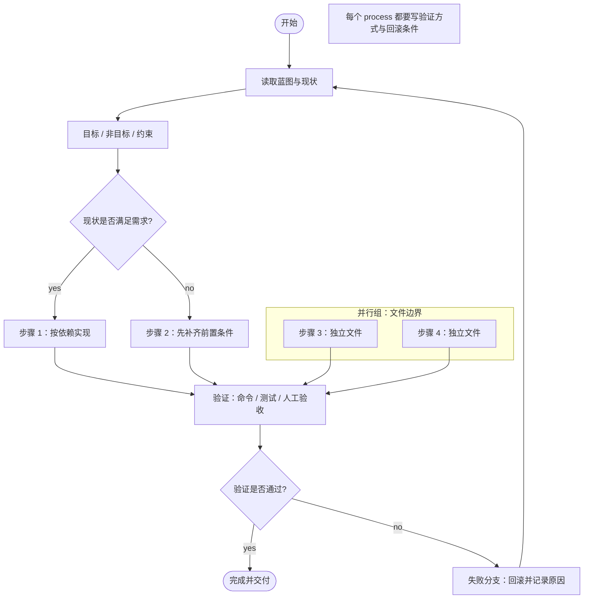

# Plan Mode（计划模式）

`v0.5` 为 Blueprint Studio 增加 Plan Flowchart（第 9 类图）、画布/分组/折叠/自上而下布局、Mermaid flowchart 导入导出、plan-mode 预置提示词与计划自检。计划图写入 `blueprint.diagrams` 的 `flowchart` 类型，客户端 UI 与分层作用域共用同一套模型。

## 使用方式

```js
import { PLAN_MODE_PROMPT, PLAN_CHECK_RULES, analyzePlan } from './lib/plan.js'

// 1. 注入系统提示或生成提示
const systemPrompt = `${basePrompt}\n\n${PLAN_MODE_PROMPT}`

// 2. 对计划图做自检；任何输入都不会抛异常
const { issues, coverage } = analyzePlan({
  nodes: [
    { id: 'start', type: 'start', label: '开始' },
    { id: 'p1', type: 'process', label: '实现登录', verification: 'node --test 通过' },
    { id: 'd1', type: 'decision', label: '测试是否通过?' },
    { id: 'end', type: 'end', label: '完成' },
  ],
  edges: [
    { from: 'start', to: 'p1', label: '开始' },
    { from: 'p1', to: 'd1', label: '实现完成' },
    { from: 'd1', to: 'end', label: 'yes' },
    { from: 'd1', to: 'p1', label: 'no：修复后重测' },
  ],
})
```

系统提示段会引用并展开 `PLAN_MODE_PROMPT`；用户确认前的实现门禁、`blueprint(confirm/dispatch)` 禁用规则、既有工具说明均保持不变。

## 预置提示词全文

以下文本由 `PLAN_MODE_PROMPT` 导出，可直接注入系统提示或作为生成提示：

````text
## 计划模式（Plan Mode）

在需要多步骤实现、跨文件改动或新功能时，先产出可审阅的实施计划，再写代码。用户明确确认计划之前，不实现、不修改文件、不启动实现型子代理。

1. 先读蓝图与现状：读取现有蓝图、相关源码、测试和配置，确认已有行为与约束；不要凭想象补业务事实。计划阶段只做只读调查，不写代码。
2. 交代基线：写清目标（Goal）、非目标（Non-goal）、硬约束（约束/兼容性/性能/安全）、当前现状与关键假设。非目标要能挡住范围蔓延，假设要标注待确认项。
3. 按依赖排序实施步骤：每个步骤说明要改什么、涉及哪些文件、为什么排在这个位置；有依赖的步骤串行，无依赖的步骤才并行。
4. 每个 decision 写清判定条件与 yes/no 两条分支：条件必须可观察、可验证；两条分支都要有去向，不能只画一条边，也不能用无标签边代替分支。
5. 标出并行分组与文件边界：用 group 圈出可并行的工作，写清各组负责的文件/目录，避免两个并行分支改同一文件；跨组接口和合并顺序单独说明。
6. 每一步都要有验证方式：写明自动化测试、命令、人工验收或可观察结果；同时给出失败/回滚分支（失败时如何止损、回退到哪个状态、如何补测）。
7. 用 Mermaid flowchart TD 输出计划图：节点只用 start / end / process / decision / group / note，边必须有标签；decision 至少有两条带标签的出边，process 在标签或 note 中写验收/验证，失败或回滚路径单独成支。
8. 计划末尾列出待用户确认的问题与风险。只有用户明确确认后，才按计划实施；实施中计划变化时先更新计划并重新确认。

计划图模板（字段可增删，但不要省略目标、非目标、约束、依赖、验证、失败分支）：



判定口头禅：没有验证方式的步骤不是计划，只有一条出边的 decision 不是决策，没有失败分支的计划不可执行。
````

## 提示词结构

`PLAN_MODE_PROMPT` 按以下顺序约束计划：

1. **先读蓝图/现状**：读取蓝图、源码、测试、配置；计划阶段只做只读调查，不写代码。
2. **基线与边界**：目标、非目标、硬约束、当前现状、关键假设；不用想象补业务事实。
3. **按依赖排序的步骤**：每步说明改动、涉及文件、依赖关系；有依赖串行，无依赖才并行。
4. **decision 的条件分支**：每个 decision 写清可观察的判定条件与 yes/no 两条去向，禁止无标签边或单边决策。
5. **并行分组与文件边界**：用 group 标注并行工作，写清各组文件/目录，避免并行分支改同一文件。
6. **每步验证与失败分支**：测试、命令、人工验收或可观察结果；失败时如何止损、回滚、补测。
7. **Mermaid 计划图**：`flowchart TD`，节点只用 `start / end / process / decision / group / note`，边必须带标签。
8. **确认门禁**：用户明确确认前不实现、不改文件、不启动实现型子代理；计划变化时先更新计划再确认。

## 实施计划模板字段

| 字段 | 必填 | 说明 |
| --- | --- | --- |
| `goals` | 是 | 本次要实现的目标，可验收。 |
| `nonGoals` | 是 | 明确不做什么，防止范围蔓延。 |
| `constraints` | 是 | 兼容性、性能、安全、依赖、文件边界等硬约束。 |
| `currentState` | 是 | 现状、已有实现、测试与风险；来自只读调查。 |
| `steps` | 是 | 按依赖排序的实施步骤，每项含目标、涉及文件、依赖。 |
| `decisions` | 按需 | 每项含判定条件、yes 分支、no 分支。 |
| `parallelGroups` | 按需 | 可并行的工作组、文件边界、合并顺序。 |
| `verification` | 每步必填 | 自动化测试、命令、人工验收或可观察结果。 |
| `failureBranch` | 每步/全局 | 失败时的止损、回滚点、降级或补测方式。 |
| `diagram` | 是 | `flowchart TD` 计划图，节点与边见下。 |

计划图节点：

| type | 含义 | 必备信息 |
| --- | --- | --- |
| `start` | 计划起点 | 唯一、可达。 |
| `end` | 交付终点 | 唯一或明确多个终点。 |
| `process` | 实施/验证步骤 | `verification` 或 `acceptance`。 |
| `decision` | 条件判断 | ≥2 条带标签出边。 |
| `group` | 并行组/文件边界 | 组内节点用 `parentGroup` 指向它。 |
| `note` | 假设、风险、补充说明 | 不参与主路径判断。 |

边：`{ from, to, label }`。decision 的出边标签建议使用 `yes` / `no` 或可观察条件；失败/回滚边必须显式出现。

## 自检规则

`analyzePlan(blueprint)` 查找计划对象：优先 `blueprint.plan` / `planGraph` / `planDiagram`，其次直接传入的 `{ nodes, edges }`，再次 `blueprint.diagrams` 中 key/type 含 `plan` 或 `flowchart` 的图，最后支持 `mermaid` / 字符串形式的 `flowchart TD`。返回：

```js
{
  issues: [{ code, severity, message, nodeId? }],
  coverage: {
    present, source, flowchart, nodeCount, edgeCount,
    startCount, endCount, decisionCount, processCount, groupCount, noteCount,
    verifiedProcessCount, unverifiedProcessCount, failureBranch,
  },
}
```

规则目录（`PLAN_CHECK_RULES`，冻结）：

| code | severity | 触发条件 | 修复建议 |
| --- | --- | --- | --- |
| `plan-flowchart-missing` | error | 没有 `flowchart TD` 或计划图节点 | 先输出计划图。 |
| `plan-terminal-missing` | error | 缺少 `start` 或 `end` | 补开始/结束节点。 |
| `plan-decision-branches` | error | decision 出边少于 2 | 增加条件不成立的另一条路径。 |
| `plan-decision-label-missing` | error | decision 存在无标签出边 | 写 `yes` / `no` 或具体条件。 |
| `plan-process-verification-missing` | error | process 没有 `verification`/`acceptance`，标签中也无验收词 | 写测试命令、人工验收或可观察结果。 |
| `plan-failure-branch-missing` | warn | 图中没有失败/回滚/降级节点或标签 | 增加失败分支与回退点。 |
| `plan-group-parent-missing` | error | 节点 `parentGroup` 指向不存在的 group | 补 group 定义或修正引用。 |
| `plan-too-many-nodes` | warn | 节点数超过 `PLAN_NODE_SOFT_LIMIT`（40） | 拆成主计划/子计划或合并重复步骤。 |
| `plan-analysis-failed` | error | 输入异常导致分析失败（兜底） | 检查计划数据结构；正常情况下不会抛异常。 |

说明：

- 所有规则只读，不修改蓝图，不写文件。
- 空输入、`null`、非对象、节点/边类型错误都返回 `plan-flowchart-missing` 或 `plan-analysis-failed`，不会抛异常。
- Mermaid 解析器只覆盖计划图常用子集：节点形状、带标签边、`subgraph` 分组；复杂 Mermaid 语法请用对象形式传入，或把验收信息写进节点标签/note。
- `process` 的验证判定会读取 `verification`、`verify`、`acceptance`、`acceptanceCriteria`，并兼容标签/描述中的「验收」「验证」「测试」等关键词。

## 与蓝图工作流的关系

1. 智能体先调用 `blueprint(action="create")` 生成需求蓝图。
2. 进入 plan mode，按 `PLAN_MODE_PROMPT` 输出计划与 `flowchart TD`，可对计划对象调用 `analyzePlan` 自检。
3. 用户确认计划后，才按模块分派实现；确认与分派仍由用户在「蓝图」面板发起并校验一次性令牌。
4. 计划图是 `blueprint.diagrams` 中的第 9 类图 `flowchart`，与需求栏、模块、验收、版本历史和导出共用同一份数据。

## 参考

- [OpenAI Codex Plan Mode 提示模板](https://github.com/openai/codex/blob/main/codex-rs/collaboration-mode-templates/templates/plan.md)：只读调查、先计划后实现、用户确认门禁。
- [GitHub Spec Kit](https://github.com/github/spec-kit)：specify → plan → tasks → implement 的阶段化规划与验收。
- [Planning Skills for Agents and Humans](https://github.com/mattlane66/planning-skills-for-agents-and-humans)：目标/非目标、决策分支、可执行计划与验证。
